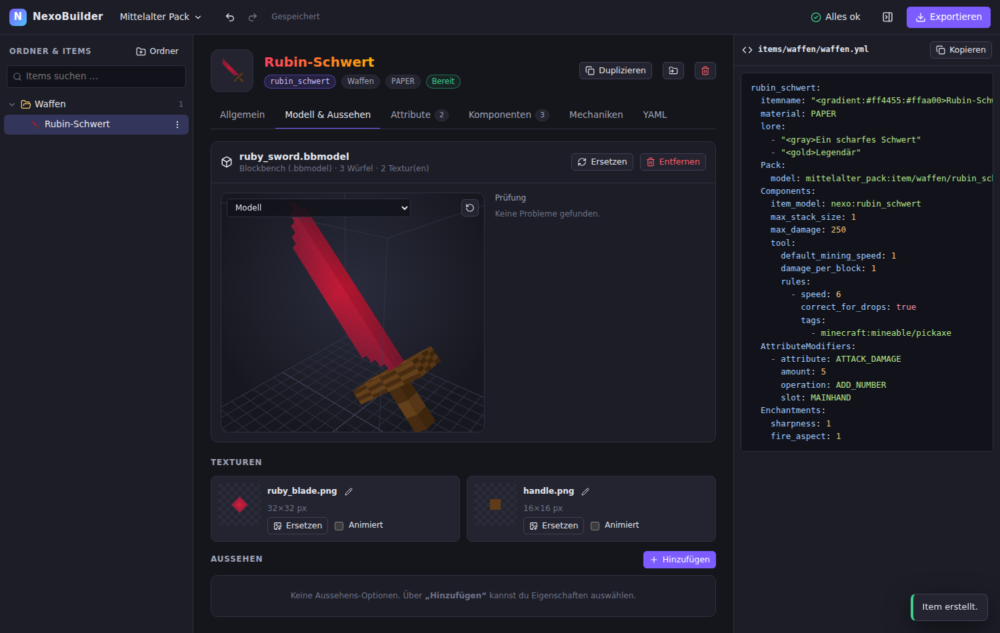

# NexoBuilder

**Aus Blockbench-Modellen fertige [Nexo](https://docs.nexomc.com/)-Items machen – inklusive Resourcepack.**

NexoBuilder ist eine Web-App (läuft komplett im Browser, auch offline per Doppelklick).
Du legst Ordner an, ziehst deine Modelle hinein, stellst die Nexo-Eigenschaften per Formular ein
und exportierst alles als ZIP, das du direkt in `plugins/Nexo/` entpackst.



## Funktionen

- **Ordner & Items** – Ordner (auch verschachtelt) werden zu Unterordnern in `plugins/Nexo/items`.
  Items per Drag & Drop verschieben, duplizieren, suchen.
- **Modell-Import per Drag & Drop**
  - `.bbmodel` (Blockbench-Projekt, Format „Java Block/Item“) – Umrechnung wie Blockbenchs eigener Java-Export
    (UVs, Rotationen inkl. freier Rotation ab 1.21.11, Inflate, Display-Einstellungen, animierte Texturen).
    Andere Blockbench-Formate (z.B. Generic Model) werden umgerechnet, mit Warnung.
  - `.json` + `.png` (Java-Modell) – Texturen werden über den Dateinamen zugeordnet, Parent-Modelle können mit abgelegt werden.
  - Nur `.png` – als 2D-Item, Werkzeug oder Block (cube_all, Säule, sechs Seiten, Pflanze …).
  - Mehrere Dateien auf einmal → mehrere Items.
- **3D-Vorschau** jedes Modells (inkl. Display-Ansichten wie Hand, Kopf, Inventar) und Vorschaubilder im Baum.
- **Nexo-Eigenschaften per Formular** (Stand Nexo 1.29 / Minecraft 26.3):
  - Allgemein: Lore (mit MiniMessage-Vorschau), unzerstörbar, Item-Flags, Templates, PersistentData
  - Attribute & Verzauberungen
  - Komponenten: Essen, Verbrauchbar, Werkzeug, Waffe, Ausrüstbar, Gleiter, Haltbarkeit, Stapelgröße, Cooldown,
    Todesschutz, Schallplatte, Tooltip, Reichweite, Brennstoff … (mit Versionshinweisen)
  - Mechaniken: Möbel (Hitbox, Sitze, Betten, Licht, Türen, Speicher, Drops …), eigene Blöcke
    (NoteBlock/StringBlock/ChorusBlock), Rucksack, Befehle, Custom-Aktionen, Rüstungs-Effekte, Ernten, Schmelzen …
  - Rüstungs-Texturen (getragen) → erzeugt Equipment-Modelle im Pack
  - Für alles andere: zusätzliches YAML pro Item
- **Rezepte** – Werkbank (mit/ohne Form), Ofen, Schmelzofen, Räucherofen, Lagerfeuer und Steinsäge
  → `recipes/<typ>/<projekt>.yml`
- **Prüfung vor dem Export** – doppelte IDs, ungültige Werte, Modelle außerhalb des erlaubten Bereichs,
  fehlende Texturen, Versionskonflikte usw.
- **Export als ZIP**
  - `items/<ordner>/<ordner>.yml` (oder eine Datei pro Item)
  - `recipes/<typ>/<projekt>.yml` (falls Rezepte angelegt wurden)
  - `pack/external_packs/<packname>/` (oder als `.zip`) mit `pack.mcmeta`, Modellen und Texturen
  - Alternativ nur der Resourcepack oder nur die Item-Configs
- **Automatisches Speichern** im Browser, Rückgängig/Wiederholen (Strg+Z / Strg+Y),
  Projektdateien zum Sichern und Weitergeben.

## Benutzung

### Variante A: Einzelne HTML-Datei (ohne Installation)

Fertig gebaut gibt es die Datei bei jedem Push unter **GitHub → Actions → Build → Artefakt „NexoBuilder“**
(`NexoBuilder.html`). Oder selbst bauen:

```bash
npm install
npm run build:single
```

Danach `dist-single/index.html` (bzw. `NexoBuilder.html`) per Doppelklick im Browser (Chrome, Edge oder Firefox) öffnen.
Die Datei kann beliebig kopiert werden und funktioniert offline.

### Variante B: Entwicklungsserver

```bash
npm install
npm run dev
```

und <http://localhost:5173> öffnen.

### Installation der exportierten Items auf dem Server

1. Export-ZIP („Für den Nexo-Ordner“) in `plugins/Nexo/` entpacken.
2. `/nexo reload` ausführen (oder Server neu starten).
3. Items mit `/nexo give <item_id>` oder über `/nexo inventory` holen.

## Was wird erzeugt?

Beispiel für ein Projekt mit dem Namespace `meinpack`:

```
items/waffen/waffen.yml
pack/external_packs/meinpack/pack.mcmeta
pack/external_packs/meinpack/assets/meinpack/models/item/waffen/rubin_schwert.json
pack/external_packs/meinpack/assets/meinpack/textures/item/waffen/rubin_schwert/klinge.png
```

```yaml
rubin_schwert:
  itemname: "<red>Rubin-Schwert"
  material: PAPER
  Pack:
    model: meinpack:item/waffen/rubin_schwert
  Components:
    item_model: nexo:rubin_schwert
    max_stack_size: 1
```

- Texturen liegen unter `textures/item/…` bzw. für eigene Blöcke unter `textures/block/…` – nur diese Ordner
  landen automatisch in den Textur-Atlanten von Minecraft.
- `Components.item_model: nexo:<id>` sorgt dafür, dass Nexo für jedes Item ein eigenes ItemModel erzeugt
  (empfohlen ab 1.21.4, abschaltbar in den Projekt-Einstellungen).
- Die YAML wird im YAML-1.1-Modus geschrieben (wie Bukkit/SnakeYAML sie liest), damit Texte wie `yes` oder `1:30`
  nicht falsch interpretiert werden.

## Entwicklung

```bash
npm test          # Unit-Tests (Konverter, YAML, Export)
npm run typecheck # TypeScript
npm run build     # Produktions-Build nach dist/
```

Aufbau:

- `src/core/model` – Import von `.bbmodel`, Java-JSON und PNG
- `src/core/nexo` – Eigenschafts-Schema, YAML-Erzeugung
- `src/core/export` – Export-Planung, Prüfungen, ZIP
- `src/ui` – Oberfläche (React), 3D-Vorschau (three.js)
